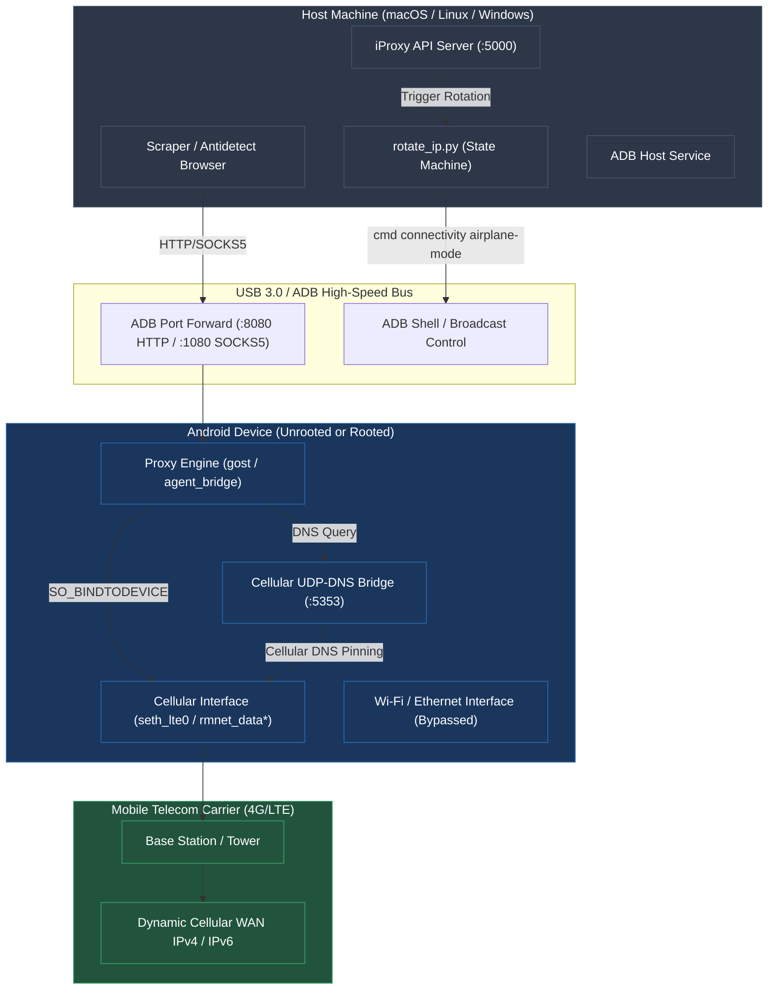

# Android ADB 4G/LTE Mobile Proxy & IP Rotator
### Универсальный мобильный 4G/LTE прокси и авто-ротатор IP через USB ADB

[](LICENSE)
[](https://www.python.org/downloads/)
[](https://android.com)

Turn any Android smartphone into an ultra-fast, zero-detection residential 4G/LTE mobile proxy via USB ADB with zero-drop cellular IP rotation and strict DNS/egress pinning.

Превратите любой Android-смартфон в высокоскоростной резидентный 4G/LTE мобильный прокси через USB ADB с мгновенной ротацией IP и защитой от утечек DNS.

---

## 🏛 Architecture / Архитектура



### Key Features / Ключевые возможности:
- **Zero-Root Operation**: Works out-of-the-box on standard retail Android firmware without unlocking the bootloader or voiding warranty.
- **Root / Magisk Policy Routing**: Optional kernel-level `ip rule` / `ip route` policy tables for enterprise high-concurrency scraping.
- **Cellular Interface Pinning**: Guarantees all proxy traffic egresses through `seth_lte0` / `rmnet_data0`, preventing accidental Wi-Fi leaks.
- **Zero-Drop Fast IP Rotation**: Sub-5-second radio cycling with automated carrier re-registration verification.
- **iProxy REST API**: Drop-in compatible endpoints (`/rotate`, `/status`, `/ip`) for antidetect browsers (Dolphin Anty, AdsPower, Multilogin, Octo, Undetectable).

---

## 🚀 Quick Start / Быстрый старт

### 1. Requirements / Требования
- Android Phone (Android 9 to Android 15) with Developer Options & USB Debugging enabled.
- Python 3.9+ installed on the host machine.
- Android platform-tools (`adb`) installed in `PATH`.

### 2. Installation / Установка
```bash
git clone https://github.com/spartak-dev/android-adb-lte-proxy.git
cd android-adb-lte-proxy

python3 -m venv venv
source venv/bin/activate
pip install -r requirements.txt

cp .env.example .env
```

### 3. Start the Proxy / Запуск прокси
```bash
# Auto-detect device and run in Zero-Root mode
python3 adb_lte_proxy.py

# Or specify device serial and custom ports
python3 adb_lte_proxy.py --serial YOUR_DEVICE_SERIAL --http-port 8080 --socks-port 1080
```

### 4. Trigger IP Rotation / Ротация IP-адреса
```bash
# CLI rotation
python3 rotate_ip.py --json

# Or start the REST API server
python3 iproxy_api.py
# Then trigger rotation via HTTP:
curl -X POST http://127.0.0.1:5000/rotate
```

---

## ⚙️ Configuration (.env)

| Variable | Default | Description |
|---|---|---|
| `ADB_SERIAL` | `""` | Target device ADB serial (from `adb devices`) |
| `CELLULAR_INTERFACE` | `seth_lte0` | Mobile data interface name (`rmnet_data0`, `seth_lte0`) |
| `PROXY_HTTP_PORT` | `8080` | Local HTTP proxy port |
| `PROXY_SOCKS_PORT` | `1080` | Local SOCKS5 proxy port |
| `API_PORT` | `5000` | Management REST API port |
| `API_KEY` | `""` | Optional secret key for securing REST endpoints |

---

## 📄 License
This project is licensed under the MIT License - see the [LICENSE](LICENSE) file for details.
Copyright (c) 2026 spartak.
